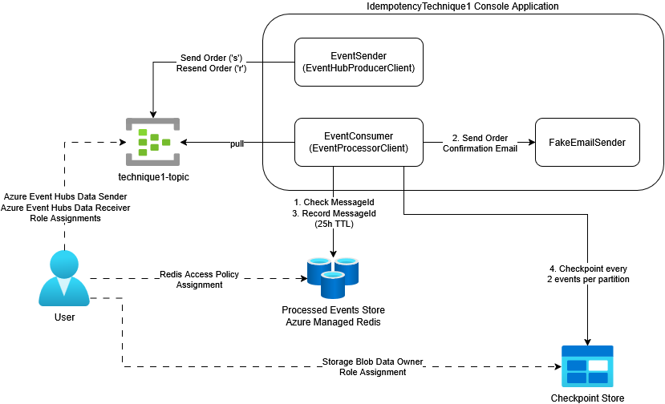
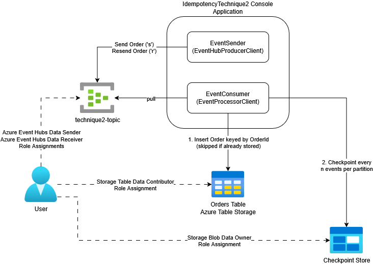
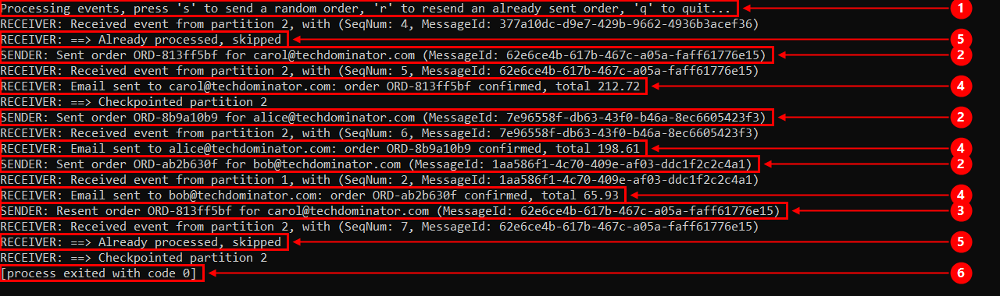
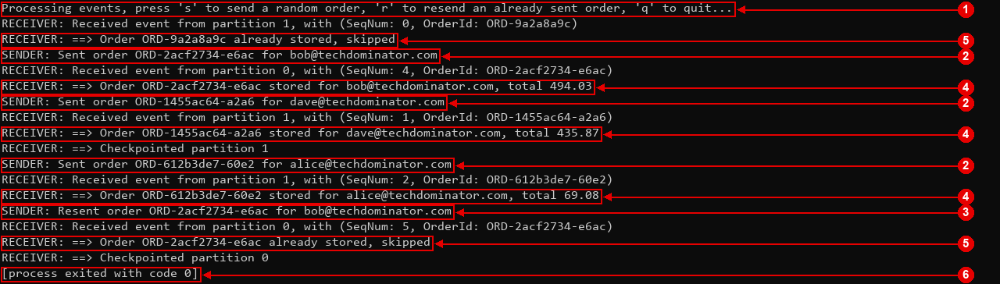

# Azure Event Hubs Idempotent Processing Sample

A set of sample C# console apps demonstrating techniques for implementing idempotent event processing with Azure Event Hubs, using the Event Hubs SDK.

Event Hubs consumers get an at-least-once delivery guarantee, the same event can reach a handler more than once:
- When sending: a producer retries a send and the event is stored twice
- When receiving: events processed after the last checkpoint are replayed when the consumer restarts

Each console app of the sample demonstrates one technique for making the processing logic idempotent:

| # | Technique | Project | Status |
|---|-----------|---------|--------|
| 1 | Remember What You Processed | `IdempotencyTechnique1` | Available |
| 2 | Rely on Natural State | `IdempotencyTechnique2` | Available |
| 3 | Remember Where You Are At | `IdempotencyTechnique3` | Placeholder, not implemented yet |
| 4 | Leverage Declarative Events | `IdempotencyTechnique4` | Placeholder, not implemented yet |

This example is discussed in the [Idempotent Event Processing With Azure Event Hubs](http://blog.techdominator.com/article/idempotent-event-processing-with-azure-event-hubs.html) blog post.

## Pre-Requisites
- [Visual Studio 2026](https://visualstudio.microsoft.com/downloads/) or Alternatively [VS Code](https://code.visualstudio.com/) with the [C# Dev Kit Extension](https://marketplace.visualstudio.com/items?itemName=ms-dotnettools.csdevkit)
- [.NET 11 SDK](https://dotnet.microsoft.com/en-us/download/dotnet/11.0), the console apps target `net11.0`
- [Powershell 7](https://learn.microsoft.com/en-us/powershell/scripting/install/install-powershell?view=powershell-7.5)
- [Azure CLI](https://learn.microsoft.com/en-us/cli/azure/install-azure-cli?view=azure-cli-latest)
- [Azure Subscription](https://azure.microsoft.com/en-us/pricing/purchase-options/azure-account)
- [Terraform](https://developer.hashicorp.com/terraform/tutorials/azure-get-started/install-cli)

## Setup Overview

All the Azure resources of the sample are created in the `rg-test-azure-event-hubs-idempotent-processing` resource group. Each technique has its own console application and its own setup, described below.

### Technique 1: Remember What You Processed

The following diagram shows the setup of the first technique:



The `IdempotencyTechnique1` console application runs a sender and a consumer concurrently, both connected to the `technique1-topic` Event Hub (3 partitions, 1 day retention) of the `evh-test-main-eventhub-ns-67fd` namespace:
- `EventSender` uses an `EventHubProducerClient` to send and resend orders on key presses
- `EventConsumer` uses an `EventProcessorClient` to pull events through the `technique1-consumer` consumer group

For each received order, the `EventConsumer` interacts with the following elements:
- **Processed Events Store:** the `amr-evh-idem-67fd` Azure Managed Redis instance, storing the `MessageId` of each processed event with a 25 hours TTL
- **FakeEmailSender:** stands in for an email provider, sending the order confirmation email is the side effect that should not happen twice
- **Checkpoint Store:** the `technique1-checkpoint` blob container of the `stevhidemcheckpoint67fd` storage account, updated every 2 events per partition

The main user's principal is granted the following accesses to allow running the sample without secrets, by using Entra ID Authentication:
- [`Azure Event Hubs Data Sender`](https://learn.microsoft.com/en-us/azure/role-based-access-control/built-in-roles/analytics#azure-event-hubs-data-sender) on the Event Hubs namespace
- [`Azure Event Hubs Data Receiver`](https://learn.microsoft.com/en-us/azure/role-based-access-control/built-in-roles/analytics#azure-event-hubs-data-receiver) on the Event Hubs namespace
- [`Storage Blob Data Owner`](https://learn.microsoft.com/en-us/azure/role-based-access-control/built-in-roles/storage#storage-blob-data-owner) on the checkpoint storage account
- `default` Redis access policy assignment on the Azure Managed Redis database (access keys are disabled)

### Technique 2: Rely on Natural State

The following diagram shows the setup of the second technique:



The `IdempotencyTechnique2` console application runs a sender and a consumer concurrently, both connected to the `technique2-topic` Event Hub (3 partitions, 1 day retention) of the same `evh-test-main-eventhub-ns-67fd` namespace:
- `EventSender` uses an `EventHubProducerClient` to send and resend orders on key presses
- `EventConsumer` uses an `EventProcessorClient` to pull events through the `technique2-consumer` consumer group

For each received order, the `EventConsumer` interacts with the following elements:
- **Orders Table:** the `orders` table of the `stevhidemorders67fd` storage account, which holds the natural state of the consumer. Each order is stored as an entity keyed by its `OrderId`, and the table rejects a second insert of the same order
- **Checkpoint Store:** the `technique2-checkpoint` blob container of the `stevhidemcheckpoint67fd` storage account, updated every 2 events per partition

There is no dedicated deduplication store: the orders table is both the state the consumer produces and the record of what it already processed.

In addition to the Technique 1 accesses, the main user's principal is granted [`Storage Table Data Contributor`](https://learn.microsoft.com/en-us/azure/role-based-access-control/built-in-roles/storage#storage-table-data-contributor) on the orders storage account.

### Technique 3: Remember Where You Are At

<<DIAGRAM: Setup overview of the IdempotencyTechnique3 console application and the Azure resources it interacts with>>

<!-- TODO: Text description of the Technique 3 setup. -->

### Technique 4: Leverage Declarative Events

<<DIAGRAM: Setup overview of the IdempotencyTechnique4 console application and the Azure resources it interacts with>>

<!-- TODO: Text description of the Technique 4 setup. -->

## Console Apps Overview

### IdempotencyTechnique1

The console app deduplicates events by remembering the `MessageId` of the events it already processed. It uses the following NuGet packages:
- [`Azure.Messaging.EventHubs`](https://www.nuget.org/packages/Azure.Messaging.EventHubs/) to send events
- [`Azure.Messaging.EventHubs.Processor`](https://www.nuget.org/packages/Azure.Messaging.EventHubs.Processor/) and [`Azure.Storage.Blobs`](https://www.nuget.org/packages/Azure.Storage.Blobs/) to consume events and checkpoint in blob storage
- [`Microsoft.Azure.StackExchangeRedis`](https://www.nuget.org/packages/Microsoft.Azure.StackExchangeRedis/) to connect to Azure Managed Redis with Entra ID
- [`Azure.Identity`](https://www.nuget.org/packages/Azure.Identity/) to authenticate with `DefaultAzureCredential`

On the sending side, the `EventSender`:
- Sends a random `OrderPlaced` event when `s` is pressed, assigning a new GUID as `MessageId`, which is the deduplication key
- Resends an already sent order when `r` is pressed, with the same body and the same `MessageId`, simulating a producer retry after a lost acknowledgment. Event Hubs stores it as a new event with its own sequence number
- Uses the order id as partition key, so a resent order lands in the same partition as the original

On the receiving side, the `EventConsumer` performs the following for each received event:

1. Check in the `ProcessedEventsStore` if the `MessageId` was already recorded, if yes the event is skipped
1. Send the order confirmation email with the `FakeEmailSender`
1. Record the `MessageId` in the `ProcessedEventsStore`, with a Redis `SET NX` and a TTL
1. Checkpoint the partition when `checkpointThreshold` events were handled since its last checkpoint

When `q` is pressed, the console app stops gracefully **without a final checkpoint.** Events handled since the last checkpoint of their partition are replayed on the next run and skipped by the consumer, which demonstrates duplicates while receiving.

The checkpoint frequency and the TTL of recorded `MessageId` values can be tweaked in `Program.cs`:

```csharp
/*
 * The TTL must exceed the worst-case replay window. Consumers can't rewind
 * further than the event hub retention (1 day), so 25 hours covers any replay
 */
TimeSpan processedEventTtl = TimeSpan.FromHours(25);

/*
 * Checkpoint every n events per partition
 */
const int checkpointThreshold = 2;
```

> Note that the email and the processed events store can't be updated in the same transaction: a crash after the email is sent and before the `MessageId` is recorded sends a duplicate email on replay.

### IdempotencyTechnique2

The console app deduplicates events by relying on the natural state of the consumer: the orders it stores. It uses the following NuGet packages:
- [`Azure.Messaging.EventHubs`](https://www.nuget.org/packages/Azure.Messaging.EventHubs/) to send events
- [`Azure.Messaging.EventHubs.Processor`](https://www.nuget.org/packages/Azure.Messaging.EventHubs.Processor/) and [`Azure.Storage.Blobs`](https://www.nuget.org/packages/Azure.Storage.Blobs/) to consume events and checkpoint in blob storage
- [`Azure.Data.Tables`](https://www.nuget.org/packages/Azure.Data.Tables/) to store orders in Azure Table storage
- [`Azure.Identity`](https://www.nuget.org/packages/Azure.Identity/) to authenticate with `DefaultAzureCredential`

On the sending side, the `EventSender`:
- Sends a random `OrderPlaced` event when `s` is pressed. No `MessageId` is assigned: the `OrderId` in the event body is the deduplication key, so the consumer doesn't rely on any event metadata
- Resends an already sent order when `r` is pressed, with the same body, simulating a producer retry after a lost acknowledgment. Event Hubs stores it as a new event with its own sequence number, carrying the same `OrderId`
- Uses the order id as partition key, so a resent order lands in the same partition as the original

On the receiving side, the `EventConsumer` performs the following for each received event:

1. Insert the order in the orders table through the `OrderRepository`, as an entity with the `OrderId` as `PartitionKey` and a constant `RowKey`
1. If the table rejects the insert with `409 Conflict` (`EntityAlreadyExists`), the order is already stored and the event is skipped
1. Checkpoint the partition when `checkpointThreshold` events were handled since its last checkpoint

There is no check before the write: the insert is the check, and it is atomic. Since the deduplication key is written in the same operation as the state change, there is no failure window between processing an event and recording it, unlike Technique 1.

When `q` is pressed, the console app stops gracefully **without a final checkpoint.** Events handled since the last checkpoint of their partition are replayed on the next run and rejected by the orders table, which demonstrates duplicates while receiving.

The checkpoint frequency can be tweaked in `Program.cs`:

```csharp
/*
 * Checkpoint every n events per partition
 */
const int checkpointThreshold = 2;
```

> Note that Table storage has no decimal type, the order total is stored as a `double` for brevity. A production consumer should store amounts in minor units (cents) as an `Int64`, or as a string.

### IdempotencyTechnique3

<!-- TODO: Overview of the Technique 3 console app. -->

### IdempotencyTechnique4

<!-- TODO: Overview of the Technique 4 console app. -->

## How to use
### 1. Create Azure Resources
Azure Resources for this sample can be created via the terraform project under `azure-resources`:
1. `cd azure-resources`
2. `terraform init`
3. `terraform apply -var subscription="<AZURE SUBSCRIPTION ID>" -var user_principal_id="<USER PRINCIPAL ID>"`

Terraform will ask for confirmation before applying the infrastructure resources.

The subscription id and the user principal id of the logged-in Azure CLI account can be retrieved with:

```ps1
az account show --query id --output tsv
az ad signed-in-user show --query id --output tsv
```

> Note that the resource names defined in terraform are also set as constants at the top of each console app's `Program.cs`. If you change a name in terraform, for example because it is already taken, update the matching constant.

### 2. Authenticate via Azure CLI
The console apps use `DefaultAzureCredential`, which picks up your Azure CLI login automatically:

```ps1
az login
```

Ensure the logged-in account is the same principal whose ID was passed to `user_principal_id` during `terraform apply`, so that the role assignments apply.

### 3. Run Technique 1
The `AzureEventHubsIdempotentProcessing.slnx` solution contains one console application per technique. Run the `IdempotencyTechnique1` console app by setting it as startup project and pressing F5 in Visual Studio, or with:

```bash
dotnet run --project IdempotencyTechnique1
```

Once the app is ready:
1. Press `s` a few times to send orders
1. Press `r` to resend an already sent order
1. Press `q` to quit
1. Run the app again to observe the replay of the events that were not checkpointed

The console app should display an output similar to the following:



1. **App ready:** the processor started and the console waits for key presses (`s` send, `r` resend, `q` quit)
2. **Sending messages:** each `s` sends a new order with a fresh `MessageId`
3. **Re-sending a message:** `r` sends an already sent order again with the same body and `MessageId`
4. **Events processed:** first time a `MessageId` is seen, the confirmation email is sent, then the `MessageId` is recorded in Redis
5. **Events already processed:** the `MessageId` is already in Redis, so the event is skipped and no duplicate email is sent. The top one is a replay of an event from an earlier run that was not checkpointed, the bottom one is the re-sent order from step 3
6. **Exiting:** `q` stops the processor gracefully and the process exits with code 0 (this line is printed by the run wrapper, not by the app)

### 4. Run Technique 2

Run the `IdempotencyTechnique2` console app by setting it as startup project and pressing F5 in Visual Studio, or with:

```bash
dotnet run --project IdempotencyTechnique2
```

Once the app is ready:
1. Press `s` a few times to send orders
1. Press `r` to resend an already sent order
1. Press `q` to quit
1. Run the app again to observe the replay of the events that were not checkpointed

The console app should display an output similar to the following:



1. **App ready:** the processor started and the console waits for key presses (`s` send, `r` resend, `q` quit)
2. **Sending messages:** each `s` sends a new order with a fresh `OrderId`
3. **Re-sending a message:** `r` sends an already sent order again with the same body and `OrderId`
4. **Orders stored:** the first insert of an `OrderId` succeeds and the order is stored in the orders table
5. **Orders already stored:** the orders table rejects the insert, so the event is skipped. The top one is a replay of an event from an earlier run that was not checkpointed, the bottom one is the re-sent order from step 3
6. **Exiting:** `q` stops the processor gracefully and the process exits with code 0 (this line is printed by the run wrapper, not by the app)

### 5. Run Technique 3

<!-- TODO: Steps to run the IdempotencyTechnique3 console app. -->

<<SCREENSHOT: Console output of a sample run of the IdempotencyTechnique3 console app>>

### 6. Run Technique 4

<!-- TODO: Steps to run the IdempotencyTechnique4 console app. -->

<<SCREENSHOT: Console output of a sample run of the IdempotencyTechnique4 console app>>

## Notes

### Globally Unique Resource Names
Some of the Azure resource names of the sample must be unique across all of Azure, since they are part of public DNS endpoints. If one of them is already taken, rename it in the terraform project and update the matching constant in the console app's `Program.cs`:
- `evh-test-main-eventhub-ns-67fd`: the Event Hubs namespace
- `amr-evh-idem-67fd`: the Azure Managed Redis instance
- `stevhidemcheckpoint67fd`: the checkpoint storage account
- `stevhidemorders67fd`: the orders storage account of Technique 2

The other resources, such as the resource group, the Event Hubs and the blob containers, only need to be unique within their parent scope and can be renamed freely.

### Caveats
The console apps keep the consumer logic short to focus on the idempotency techniques, and take shortcuts a production consumer shouldn't:
- **Error handler:** `ProcessErrorHandler` logs every error as unexpected. The processor reports its own errors there, such as a lost partition ownership or a transient service failure, which are expected occasionally, especially when several consumer instances run. Exceptions thrown by the event handler don't reach it.
- **Checkpoint counters:** the per partition counters are kept in memory and are not reset when a partition is handed over to another consumer, so the checkpoint cadence drifts after an ownership change. Handling `PartitionClosingAsync` would reset them.
- **Technique 2 failure window:** the orders table closes the failure window only because inserting the order is the single side effect. Adding another side effect after the insert, such as sending an email, brings back the failure window of Technique 1.
- **Technique 2 concurrent duplicates:** the orders table also rejects an order inserted concurrently by two consumers, which can happen when partition ownership changes, but the sample runs a single consumer and doesn't demonstrate it. Since the order id is the partition key, an order and its resent duplicate always land in the same partition and are handled sequentially.

### Azure Resources Cleanup
After finishing using the sample, remember **to remove the azure resources** to avoid incurring unnecessary costs on your Azure Subscription.

This can be done with Terraform by running:
```bash
terraform destroy -var subscription="<AZURE SUBSCRIPTION ID>" -var user_principal_id="<USER PRINCIPAL ID>"
```

## Contributing

Please checkout [the contribution guidelines](../CONTRIBUTING.md) for contributing.
