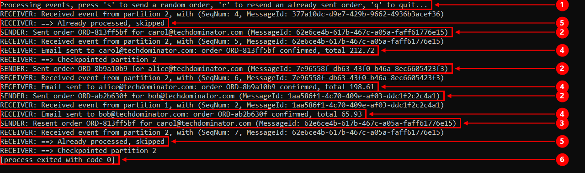

# Technique 1 – Sample run

1. **App ready** – the processor started and the console waits for key presses (`s` send, `r` resend, `q` quit).
2. **Sending messages** – each `s` sends a new order with a fresh `MessageId`, the deduplication key.
3. **Re-sending a message** – `r` sends an already sent order again with the same body and `MessageId`, simulating a producer retry. Event Hubs stores it as a new event (new sequence number).
4. **Events processed** – first time a `MessageId` is seen: the confirmation email is sent, then the `MessageId` is recorded in Redis.
5. **Events already processed** – the `MessageId` is already in Redis, so the event is skipped and no duplicate email is sent. The top one is a replay of an event from an earlier run that was not checkpointed. The bottom one is the re-sent order from step 3.
6. **Exiting** – `q` stops the processor gracefully and the process exits with code 0 (this line is printed by the run wrapper, not by the app).
